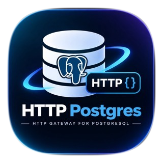
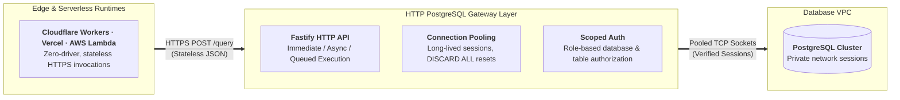

<div align="center">

  

  <h1>HTTP PostgreSQL Gateway</h1>
  <h3>Official Developer Documentation Portal</h3>

  <p>
    A persistent, high-performance HTTP bridge to PostgreSQL designed for serverless functions, edge runtimes, and distributed microservices. Features connection pooling, fine-grained role-based CRUD scopes, and atomic multi-statement transactions.
  </p>

  <p>
    <a href="https://github.com/http-postgres/http-postgres"></a>
    <a href="https://nuxt.com"></a>
    <a href="https://docus.dev"></a>
    <a href="https://github.com/http-postgres/http-postgres-docs/blob/main/LICENSE"></a>
  </p>

</div>

---

## Architecture Overview



---

## Quick Integration

Query your private PostgreSQL cluster directly from any serverless environment using standard `fetch()`:

```typescript
// Zero native drivers, zero socket bindings
export async function queryDatabase(sql: string, params: unknown[] = []) {
  const response = await fetch(`${process.env.PG_GATEWAY_URL}/query`, {
    method: 'POST',
    headers: {
      'content-type': 'application/json',
      'x-api-key': process.env.PG_GATEWAY_API_KEY!,
      'x-database': process.env.PG_GATEWAY_DATABASE!,
    },
    body: JSON.stringify({ query: sql, parameters: params }),
  });

  const payload = await response.json();
  if (!response.ok) {
    throw new Error(payload.error?.code ?? `HTTP_${response.status}`);
  }

  return payload.data;
}
```

---

## Documentation Structure

The documentation portal is organized into 5 core sections:

```text
content/
├── 1.getting-started/       # Introduction, local quickstart, docker-compose, architecture
├── 2.serverless/            # Edge overview, zero-driver client, execution modes, timeouts
├── 3.api-reference/         # Queries, transactions, admin APIs, CRUD scopes, error catalog
├── 4.configuration/         # Complete gateway.yaml spec, pool sizing, analytics, runtime files
└── 5.operations/            # Production deployment, Docker/systemd, security checklist
```

### Key Topics Covered

- **[Getting Started](/getting-started/quickstart):** Start the gateway locally with Docker Compose, initialize administrative credentials, create API keys, and execute queries.
- **[Serverless Integration](/serverless/overview):** Solve direct database connection exhaustion and edge TCP socket limitations without proprietary SDKs.
- **[Execution Modes](/serverless/execution-modes):** Compare Immediate Queries, Asynchronous Polled Queries, Single-Request Atomic Batches, and Queued Transactions.
- **[API Reference](/api-reference/overview):** Complete HTTP contract with lossy-type protection, schema scopes (`c`, `r`, `u`, `d`), and actionable error codes.
- **[Connection Pools & Sizing](/configuration/connection-pools):** Formula for sizing administrative and query pools within PostgreSQL `max_connections`.
- **[Production Operations](/operations/deployment):** Recommended reverse-proxy topology, TLS termination, systemd configuration, and security hardening.

---

## Local Development

### Prerequisites

- **Node.js**: 22.13+ or 23.4+ (LTS recommended)
- **Package Manager**: npm 10+

### Setup

```bash
# 1. Clone documentation repository
git clone https://github.com/http-postgres/http-postgres-docs.git
cd http-postgres-docs

# 2. Install dependencies
npm install

# 3. Start development server with live reload
npm run dev
```

The portal runs by default at `http://localhost:3000`.

### Production Build

```bash
# Compile and pre-render all static documentation routes
npm run build

# Preview production build locally
npm run preview
```

---

## Tech Stack

- **Framework**: [Nuxt 4](https://nuxt.com) with Nitro Engine
- **Theme Layer**: [Docus](https://docus.dev) documentation theme & [Nuxt UI](https://ui.nuxt.com)
- **Syntax Highlighting**: [React Syntax Highlighter](https://www.npmjs.com/package/react-syntax-highlighter) (Prism `vscDarkPlus` theme)
- **Diagrams**: [Mermaid](https://www.npmjs.com/package/mermaid) (interactive client-side SVG rendering with dark-emerald theming)
- **Markdown & Prose**: [@nuxtjs/mdc](https://github.com/nuxt-modules/mdc) with custom callouts and code blocks

---

## Related Resources

- **Core Gateway Repository:** [http-postgres/http-postgres](https://github.com/http-postgres/http-postgres)
- **Issues & Support:** [GitHub Issues](https://github.com/http-postgres/http-postgres/issues)

---

## License

This documentation portal is licensed under the [MIT License](LICENSE).
