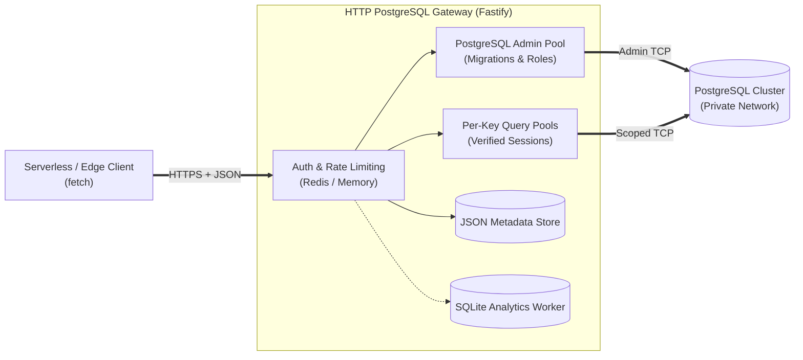

# Introduction to HTTP PostgreSQL Gateway

**HTTP PostgreSQL Gateway** is a persistent bridge between HTTP-only runtimes and PostgreSQL. It allows serverless and edge clients to make stateless HTTPS requests while the gateway maintains reusable PostgreSQL connection pools on a private network where TCP or Unix-socket database access is available.

---

## The Serverless Database Dilemma

Serverless platforms like **Cloudflare Workers**, **Vercel Functions**, **AWS Lambda**, **Deno Deploy**, and **Bun** present unique operational challenges when connecting directly to relational databases:

- **No Direct Socket Support:** Many edge runtimes (such as V8 isolates) cannot open raw TCP sockets to PostgreSQL.
- **Connection Storms:** Each serverless instance opens its own TCP connection. Spikes in concurrent traffic can quickly exhaust PostgreSQL's `max_connections` limit.
- **Expensive TLS Handshakes:** Re-establishing TLS connections and authenticating with PostgreSQL on every cold start introduces significant latency.
- **Distributed Database Secrets:** Storing master database credentials inside numerous client-side or distributed deployment configs increases exposure risk.

HTTP PostgreSQL Gateway solves these problems by providing a high-performance HTTP front-end that lives close to PostgreSQL, manages the backend connection lifecycle, and enforces strict authorization.

---

## Core Capabilities

::u-page-grid
  :::u-page-card
  ---
  icon: i-lucide-zap
  title: Native fetch() Support
  to: /serverless/minimal-client
  ---
  #description
  Query PostgreSQL using standard HTTPS JSON requests without native binary drivers or socket shims.
  :::

  :::u-page-card
  ---
  icon: i-lucide-database
  title: Persistent Connection Pooling
  to: /configuration/connection-pools
  ---
  #description
  Maintains prewarmed, verified PostgreSQL sessions with automatic `DISCARD ALL` rollbacks and resets.
  :::

  :::u-page-card
  ---
  icon: i-lucide-shield-check
  title: Scoped Database Roles
  to: /api-reference/scopes-permissions
  ---
  #description
  Maps API keys to dynamically provisioned, least-privilege PostgreSQL roles with granular CRUD permissions (`c`, `r`, `u`, `d`).
  :::

  :::u-page-card
  ---
  icon: i-lucide-layers
  title: Idempotent Atomic Batches
  to: /api-reference/transactions
  ---
  #description
  Submit multi-statement transactions with `Idempotency-Key` headers to guarantee exactly-once commit behavior.
  :::

  :::u-page-card
  ---
  icon: i-lucide-clock
  title: Asynchronous Query Queue
  to: /api-reference/queries
  ---
  #description
  Queue queries that outlast typical serverless execution windows (up to 5 minutes) and poll for results.
  :::

  :::u-page-card
  ---
  icon: i-lucide-activity
  title: Built-in Observability
  to: /configuration/analytics
  ---
  #description
  Worker-thread SQLite analytics, query counting, and automatic SQL literal sanitization for failed queries.
  :::
::

---

## Architecture at a Glance

The service separates **administrative database access** from **client query access**. API-key scopes are translated directly into PostgreSQL roles, ensuring that PostgreSQL remains the ultimate authorization boundary for SQL execution.

---

## Gateway vs. Other Solutions

| Feature | Direct Driver | PgBouncer / Pgpool | HTTP PostgreSQL Gateway |
| :--- | :--- | :--- | :--- |
| **Protocol** | Native TCP | Native TCP | **HTTPS / JSON (`fetch()`)** |
| **Edge Isolation Friendly** | No (requires TCP) | No (requires TCP) | **Yes (Native HTTP)** |
| **Credential Distribution** | DB passwords in functions | DB passwords in functions | **Scoped Bearer API Keys** |
| **Authorization Boundary** | Client SQL string | Client SQL string | **PostgreSQL Role per Scope** |
| **Async Execution** | None | None | **Yes (Persistent background queue)** |
| **Idempotent Transactions** | Client managed | Client managed | **Yes (`Idempotency-Key` tracking)** |
| **Failed SQL Sanitization** | Application logs | Raw logs | **Yes (Auto-redacted analytics)** |

---

## Next Steps

- Follow the [Quickstart Guide](/getting-started/quickstart) to run the gateway locally in 5 minutes.
- Learn about the [Serverless Integration Pattern](/serverless/overview) and review the [Minimal Client](/serverless/minimal-client).
- Explore all supported execution methods in the [API Routes Reference](/api-reference/overview).
- Inspect the [Security Hardening Guide](/operations/security) before deploying to production.
