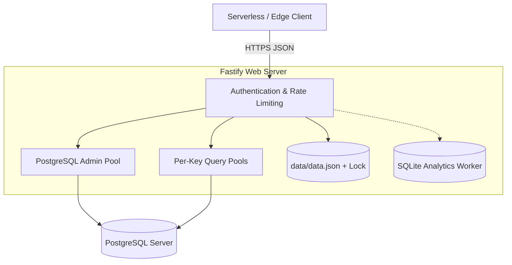
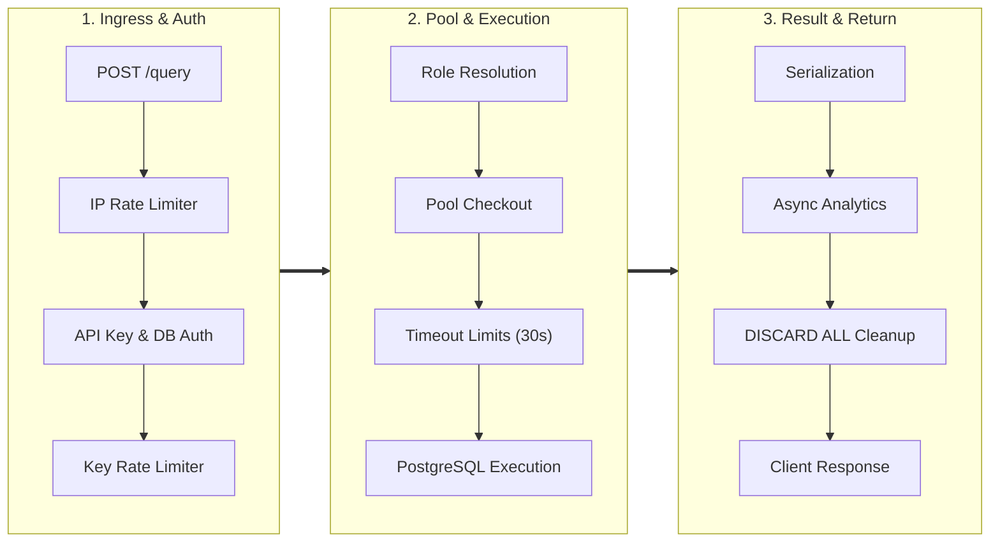

# Architecture & State Ownership

HTTP PostgreSQL Gateway is designed as a persistent, high-throughput bridge between short-lived HTTP-only environments and a private PostgreSQL cluster. It maintains long-lived TCP connections, enforces fine-grained authorization, and coordinates state across background workers.

---

## Component Topology

---

## Core Subsystems

### 1. HTTP Layer (Fastify)
Fastify manages request routing, JSON parsing, payload size enforcement, compression, and error responses. Authentication and rate limiting execute as early lifecycle hooks. Public access is strictly limited to `GET /health` and `HEAD /health`.

### 2. Administrative PostgreSQL Pool
A dedicated connection pool configured by `database.url` serves internal gateway operations:
- Verifying database identities and validating schemas.
- Managing persistent execution state in the `http_postgres_gateway` schema.
- Performing administrative actions (creating/renaming databases, listing tables).
- Provisioning restricted PostgreSQL roles for scoped API keys.

::warning
The admin pool is completely segregated from client query pools. Client queries never execute on the administrative connection.
::

### 3. Per-Key Query Pools
Client SQL runs through isolated pools segregated by database name and API key identity.
- **Verification:** Before checkout, each session is verified against PostgreSQL's `pg_stat_activity` to guarantee it is idle and healthy.
- **Session Reset:** After every request, the gateway issues `DISCARD ALL` and rolls back uncommitted transactions before returning the connection to the pool.
- **Global Budgeting:** A process-wide connection cap (`database.pool.maxGlobalQueries`) bounds total query connections across all pools.

### 4. API-Key Metadata Store (`data/data.json`)
Stores the administrator password hash, API key records, database identity bindings, and HMAC seed material used to derive credentials for scoped PostgreSQL roles. Writers are serialized using a SQLite lock file (`data/data.json.lock`).

### 5. Rate-Limit Store
- **Redis Mode (Production):** Distributed atomic counters shared across multiple gateway replicas using Redis `EVAL` scripts.
- **In-Memory Mode (Local Dev):** Process-local rate-limiting windows when Redis is disabled.

### 6. SQLite Analytics Worker
Query counts and failed-query diagnostics are buffered in memory and flushed asynchronously to SQLite via a dedicated worker thread. Analytics writes never block SQL execution.

---

## Request Lifecycle

The lifecycle of an authenticated client query through the three core phases:

---

## Execution Modes & Durability Matrix

| Work Type | Input / Queue Location | Outcome Storage | Restart Behavior |
| :--- | :--- | :--- | :--- |
| **Immediate Query** | Request memory | HTTP response body | No replay; outcome unknown if interrupted |
| **Async Query** | Process scheduler | `http_postgres_gateway.async_queries` | Record survives; interrupted work not replayed |
| **Atomic Batch** | Process scheduler | `http_postgres_gateway.transactions` | Record survives; idempotent retry supported |
| **Queued Transaction** | Process heap memory | Process heap until committed | Lost on restart; must be recreated |

---

## Transaction Lifecycle & Commit Staging

For atomic batches (`POST /transaction/execute`):

1. **Idempotency Check:** If an `Idempotency-Key` header is present, the gateway verifies the normalized fingerprint against previous submissions.
2. **Persistence:** The batch is recorded in PostgreSQL in the `http_postgres_gateway.transactions` table with status `pending`.
3. **Execution:** Statements are executed in order inside a transaction block.
4. **Result Staging:** Results are staged before issuing `COMMIT`.
5. **Commit Confirmation:** The gateway commits the transaction and immediately updates status to `committed`. Results are exposed only after commit confirmation is written.
6. **Failure & Unknown States:** If connection to PostgreSQL is lost during `COMMIT`, the transaction status becomes `unknown`. The client must inspect application state before retrying.

---

## Scaling Boundaries & Multi-Process Clusters

When scaling to multiple gateway instances behind a load balancer:

- **Durable Records:** Async query and atomic batch records in `http_postgres_gateway` can be read or polled by any replica connected to the same administrative database.
- **Shared Metadata:** Replicas must share `data/data.json` over a filesystem that provides reliable POSIX SQLite locking and atomic file renaming.
- **Distributed Rate Limiting:** Redis is required for unified rate limits across replicas.
- **Queued Transactions:** Interactive queued transactions are held in process memory. Workflows using queued transactions require sticky sessions (session affinity).
