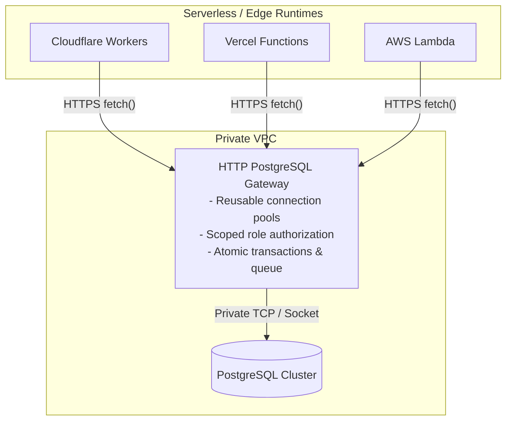

# Serverless & Edge Integration

HTTP PostgreSQL Gateway is specifically built for runtimes that support outbound HTTPS requests but cannot or should not establish direct TCP connections to PostgreSQL.

---

## Deployment Architecture

::warning
**Deploy the gateway as a long-running persistent daemon** inside your private database network (e.g., AWS ECS, EKS, GCP Cloud Run with min-instances, or standard VMs). Never package or start the gateway inside individual serverless function invocations.
::

---

## Key Benefits for Serverless

### 1. Zero Native Driver Dependencies
Native PostgreSQL client libraries (like `pg-native` or libpq bindings) require compiled C++ binaries that complicate deployment packages, increase bundle size, and frequently break across different serverless architectures (x86 vs ARM). HTTP PostgreSQL Gateway works with standard `fetch()`, available natively in modern Node.js, Deno, Bun, and browser-like runtimes.

### 2. Elimination of Connection Starvation
When traffic spikes from 10 to 1,000 concurrent serverless invocations, a direct database connection model attempts to open 1,000 direct TCP connections. PostgreSQL quickly runs out of memory or crashes with `FATAL: sorry, too many clients already`.

With HTTP PostgreSQL Gateway:
- Serverless invocations make fast HTTP requests to the gateway.
- The gateway multiplexes requests across a fixed, bounded pool of long-lived PostgreSQL connections.
- Queued requests wait briefly for a warm connection or fail gracefully before overwhelming PostgreSQL.

### 3. Lower Cold-Start Latency
Direct TCP database connections require:
1. TCP handshake (1 RTT)
2. TLS handshake (1-2 RTTs)
3. PostgreSQL authentication & startup negotiation (1-2 RTTs)

The gateway maintains prewarmed connections to PostgreSQL. Serverless requests over persistent HTTPS or HTTP/2 keep TLS connections warm, reducing query overhead during cold starts.

### 4. Elimination of Master Password Distribution
Instead of embedding master database credentials across dozens of microservices or edge deployments, each service receives a **scoped API key**. If an API key is compromised, its access is strictly bounded to specific tables and CRUD operations, and it can be revoked instantly without restarting PostgreSQL or cycling master database credentials.

---

## Supported Serverless & Edge Runtimes

The gateway is compatible with any runtime that supports standard HTTPS and JSON:

| Runtime | Transport | Environment Variable Configuration |
| :--- | :--- | :--- |
| **Cloudflare Workers** | Standard `fetch()` | `wrangler.toml` encrypted secrets |
| **Vercel Functions** | Standard `fetch()` | Vercel Project Environment Variables |
| **AWS Lambda** | Node 20+ `fetch()` | AWS Systems Manager / Secrets Manager |
| **Deno Deploy** | Built-in `fetch()` | Deno Deploy Dashboard Environment Variables |
| **Bun** | Native `fetch()` | `.env` or Bun environment variables |
| **Google Cloud Functions** | Native `fetch()` | Secret Manager binding |

---

## Next Steps

- Implement the [Minimal fetch() Client](/serverless/minimal-client).
- Understand [Timeouts and Retry Rules](/serverless/timeouts-and-retries) to prevent accidental double-writes.
- Review [Execution Modes](/serverless/execution-modes) to pick the right strategy for your workload.
