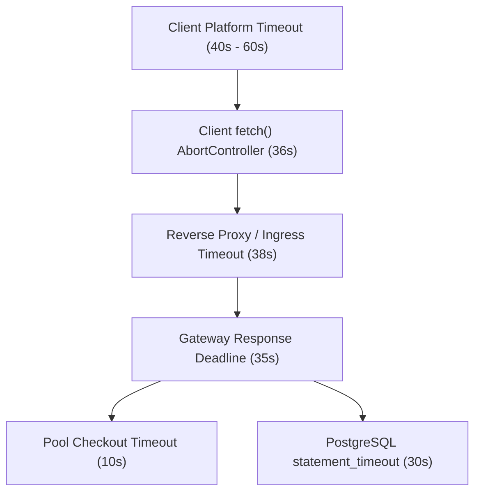

# Timeouts, Deadlines & Safe Retries

Connecting stateless serverless functions to relational databases over HTTP requires careful handling of network interruptions. A failed HTTP request does **not** guarantee that PostgreSQL aborted the statement.

---

## The Timeout Hierarchy

Multiple independent timeouts govern a single query request. Always size outer timeouts slightly larger than inner timeouts:



### Why Timeouts Must Be Staggered

If your client `fetch()` timeout is 30 seconds, but the gateway's PostgreSQL statement timeout is 30 seconds, a client-side abort will trigger before the gateway can receive PostgreSQL's response and construct a clean error envelope. Setting the client timeout to **36 seconds** allows the gateway's 35-second deadline to return a structured error response with actionable diagnostic codes.

---

## The Danger of "Outcome Unknown"

When an HTTP client aborts a request, or if a network disconnect occurs while a query is running:

::warning
**Aborting an HTTP request does NOT automatically cancel the server-side PostgreSQL statement.**
PostgreSQL may continue executing the query and commit the write. Blindly retrying the request can result in **duplicate inserts, double charges, or corrupt state**.
::

### Identifying Unknown Outcomes

The gateway explicitly surfaces when an outcome cannot be confirmed:

- **Immediate Queries:** Returns HTTP `500` with code `QUERY_OUTCOME_UNKNOWN`. The underlying cause (such as `EXECUTION_DEADLINE_EXCEEDED` or client disconnect) is provided in `error.cause`.
- **Transactions:** A status of `"unknown"` indicates that `COMMIT` was issued to PostgreSQL, but the gateway lost connection before receiving the confirmation.

When encountering an unknown outcome:
1. **Do NOT blindly retry the write.**
2. Inspect application state (e.g., query by a natural unique identifier, idempotency token, or timestamp).
3. If the record already exists, treat the operation as successful.
4. If the record does not exist, safe retry can proceed.

---

## Safe Retry Decision Tree

| Returned Error Code | Phase | Safe to Retry? | Reason |
| :--- | :--- | :--- | :--- |
| `QUERY_POOL_BUSY` (503) | Pre-dispatch | **Yes** | Connection was never acquired; SQL never sent |
| `QUERY_CONNECTION_LIMIT` (503) | Pre-dispatch | **Yes** | Global connection limit reached; SQL never sent |
| `INVALID_QUERY_TYPE` (400) | Validation | **No** | Schema error; fix client request |
| `INSUFFICIENT_PRIVILEGE` (403) | PostgreSQL | **No** | Key lacks database/table permissions |
| `QUERY_OUTCOME_UNKNOWN` (500) | Post-dispatch | **Conditional** | Check application state first before retrying |
| Transaction `unknown` status | Commit phase | **Conditional** | Check application state first before retrying |
| `IDEMPOTENCY_KEY_CONFLICT` (409) | Pre-dispatch | **No** | Reusing the same key with different SQL |

::caution
**Disable automatic POST retries** in reverse proxies (such as Nginx, Envoy, AWS ALB) and HTTP client libraries (such as Axios, got, or Cloudflare Workers `cf.cacheTtl`). Automatic retries should only apply to idempotent `GET` requests.
::

---

## Idempotent Writes with `Idempotency-Key`

For multi-statement write transactions (`POST /transaction/execute`), always include a unique `Idempotency-Key` header:

```bash
curl -X POST http://localhost:8080/transaction/execute \
  -H 'x-api-key: <api-key>' \
  -H 'x-database: billing' \
  -H 'Idempotency-Key: ord_checkout_9182374' \
  -H 'content-type: application/json' \
  -d '{
    "queries": [
      {"query": "INSERT INTO orders (id, total) VALUES ($1, $2)", "parameters": ["ord_checkout_9182374", 49.99]}
    ]
  }'
```

### Idempotency Mechanics
1. **First Submission:** The gateway normalizes the SQL and parameters, computes a cryptographic fingerprint, and creates a record with status `pending`.
2. **Replay on Network Drop:** If the client loses connection and resubmits the exact same request with the same `Idempotency-Key`, the gateway detects the match and returns `200 OK` with the existing transaction status without re-executing the statements.
3. **Conflict Detection:** If the client reuses an `Idempotency-Key` with different SQL or parameters, the gateway rejects it immediately with `409 IDEMPOTENCY_KEY_CONFLICT`.

---

## Serverless Production Checklist

Before rolling out serverless functions to production, verify each item:

- [ ] Function invocation timeout is comfortably larger than 36 seconds.
- [ ] Client `fetch()` uses an `AbortController` set to 36 seconds.
- [ ] Reverse proxies and HTTP clients have automatic POST retries disabled.
- [ ] Gateway base URL, database name, and API keys are stored in encrypted secret managers.
- [ ] Scoped API keys are restricted to specific tables and CRUD operations.
- [ ] All dynamic query values use `$1, $2` parameters rather than string concatenation.
- [ ] Batch write transactions provide stable `Idempotency-Key` headers.
- [ ] Application logic reconciles `QUERY_OUTCOME_UNKNOWN` before triggering manual retries.
