# Transaction API Reference

HTTP PostgreSQL Gateway supports two transaction models: **Single-Request Atomic Batches** (recommended for serverless) and **Interactive Queued Transactions**.

---

## Single-Request Atomic Batches

Execute an ordered batch of 1 to 100 SQL statements inside an atomic transaction block.

- **Endpoint:** `POST /transaction/execute`
- **Headers:** `x-api-key`, `x-database`, `content-type: application/json`
- **Optional Header:** `Idempotency-Key: <unique-token>`

### Request Body

```json
{
  "queries": [
    {
      "query": "UPDATE accounts SET balance = balance - $1 WHERE id = $2",
      "parameters": [100.00, 42]
    },
    {
      "query": "UPDATE accounts SET balance = balance + $1 WHERE id = $2",
      "parameters": [100.00, 99]
    },
    {
      "query": "INSERT INTO transfers (from_id, to_id, amount) VALUES ($1, $2, $3)",
      "parameters": [42, 99, 100.00]
    }
  ],
  "options": {
    "isolationLevel": "serializable",
    "readOnly": false,
    "deferrable": false,
    "arrayMode": false
  }
}
```

### Transaction Options

| Field | Type | Default | Description |
| :--- | :--- | :--- | :--- |
| `isolationLevel` | `string` | Database default | `read committed`, `repeatable read`, `serializable`, or `read uncommitted`. |
| `readOnly` | `boolean` | `false` | Sets PostgreSQL `READ ONLY` transaction mode. |
| `deferrable` | `boolean` | `false` | Sets PostgreSQL `DEFERRABLE` mode (only valid with `serializable` and `readOnly`). |
| `arrayMode` | `boolean` | `false` | Returns row results as positional arrays. |
| `fullResults` | `boolean` | `true` | Includes statement metadata in the output. |

### Lifecycle & Status Codes

When a batch is submitted, the gateway records it in PostgreSQL (`http_postgres_gateway.transactions`) and returns `202 Accepted` with a `transactionId` and `Location` header.

Poll `GET /transaction/:id` with the same `x-api-key` and `x-database`:

```json
{
  "success": true,
  "data": {
    "transactionId": "tx_01jk98q...",
    "status": "committed",
    "finalized": true,
    "progress": {
      "completed": 3,
      "total": 3
    },
    "outcome": {
      "status": 200,
      "payload": {
        "results": [
          {"command": "UPDATE", "rowCount": 1},
          {"command": "UPDATE", "rowCount": 1},
          {"command": "INSERT", "rowCount": 1}
        ]
      }
    }
  }
}
```

### Transaction Status Meanings

| Status | State | Description |
| :--- | :--- | :--- |
| `pending` | In Progress | Accepted and queued for execution. |
| `running` | In Progress | Statements currently executing in PostgreSQL. |
| `committing` | In Progress | Statements finished; `COMMIT` has been sent to PostgreSQL. |
| `committed` | Final | All statements successfully committed. Results available in `outcome.payload.results`. |
| `rejected` | Final | Statement failed or transaction was rolled back. Error details in `outcome.payload.error`. |
| `failed` | Final | Gateway execution aborted before commit confirmation. |
| `unknown` | Final | Commit confirmation was lost. Verify database state before retrying! |

---

## Idempotency Keys (`Idempotency-Key`)

To prevent duplicate mutations during network timeouts or retry storms, supply a unique `Idempotency-Key` header (1 to 128 characters, matching `^[a-zA-Z0-9._~-]+$`):

```bash
curl -X POST http://localhost:8080/transaction/execute \
  -H 'x-api-key: <api-key>' \
  -H 'x-database: sales' \
  -H 'Idempotency-Key: pay_order_129487' \
  -d '{"queries": [...]}'
```

### Behavior:
- **First Call:** Stores the fingerprint of the normalized SQL and parameters, returns `202 Accepted`.
- **Identical Replay:** Repeating the request with the identical key and identical batch returns `200 OK` with the existing transaction ID and status without re-executing SQL.
- **Key Conflict:** If the same key is reused with different SQL, parameters, or statement order, the gateway rejects the request with `409 IDEMPOTENCY_KEY_CONFLICT`.
- **Tombstones:** When a transaction is deleted or pruned, a tombstone is retained for `transactions.retentionDays`. Subsequent lookups or replays return `410 TRANSACTION_RECORD_REMOVED`.

---

## Interactive Queued Transactions

For workflows that construct a transaction across multiple sequential HTTP calls:

```mermaid
sequenceDiagram
  autonumber
  participant Client
  participant Gateway
  participant PostgreSQL

  Client->>Gateway: POST /transaction/create
  Gateway-->>Client: 201 Created (transactionId)

  Client->>Gateway: POST /transaction/add (statement 1)
  Gateway-->>Client: 200 OK (queryId 1)

  Client->>Gateway: POST /transaction/add (statement 2)
  Gateway-->>Client: 200 OK (queryId 2)

  opt Optional Removal
    Client->>Gateway: POST /transaction/remove (queryId 1)
    Gateway-->>Client: 200 OK (statement removed)
  end

  Client->>Gateway: POST /transaction/add (COMMIT)
  Gateway->>PostgreSQL: BEGIN -> Stmt 2 -> COMMIT
  PostgreSQL-->>Gateway: All statements executed
  Gateway-->>Client: 200 OK (Full transaction results)
```



### 1. Create Queued Transaction
`POST /transaction/create` (or `POST /transaction`)
Returns `201 Created` with `transactionId`.

### 2. Add Statements
`POST /transaction/add`
Pass header `transaction-id: <tx-id>` and JSON body `{"query": "INSERT INTO items...", "parameters": [...]}`.
Returns `201 Created` with `transactionId` and statement `queryId`.

### 3. Remove a Statement
`POST /transaction/remove` or `DELETE /transaction/remove`
Pass header `transaction-id` and `query-id` to cancel a specific queued statement.

### 4. Inspect Queue
`GET /transaction` with header `transaction-id`.
Returns queued statements and current status.

### 5. Commit Transaction
Send `{"query": "COMMIT"}` to `POST /transaction/add` with header `transaction-id`.
The gateway checks out a single PostgreSQL connection, wraps statements in `BEGIN ... COMMIT`, and returns results.

::warning
Queued transactions reside entirely in **process memory** and expire after **15 minutes** of inactivity. They are lost if the gateway restarts and require sticky sessions in multi-replica deployments.
::
