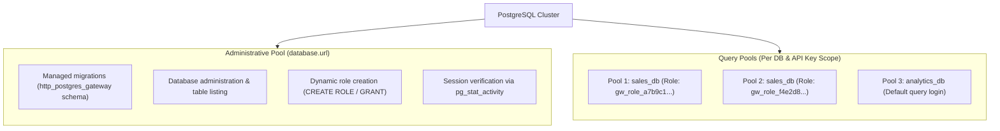

# Connection Pools & Sizing Reference

The gateway maintains long-lived PostgreSQL connection pools so ephemeral serverless clients do not overwhelm the database.

---

## Dual-Pool Architecture

The gateway maintains two distinct classes of pools:



1. **Administrative Pool:** Dedicated exclusively to gateway internal operations and health checks. Sized by `database.pool.min` and `database.pool.max`.
2. **Query Pools:** One dedicated pool is maintained for each unique combination of target database and provisioned API-key role.

---

## Sizing Guidelines

### Sizing Formula

When configuring pool caps across multiple gateway processes, ensure total potential connections remain well within PostgreSQL's `max_connections`:

$$\text{Total Connections} = N_{\text{processes}} \times \left( \text{pool.max}_{\text{admin}} + \text{maxGlobalQueries} \right) + \text{Operator Headroom}$$

### Recommended Settings

For a typical production deployment with a PostgreSQL instance having `max_connections = 200`:

```yaml
database:
  pool:
    min: 2
    queryMin: 2
    max: 20
    maxGlobalQueries: 60
    connectionTimeoutMillis: 10000
    checkoutTimeoutMillis: 10000
    growthIntervalMillis: 0
    maxConcurrentOpenings: 4
    statementTimeoutMillis: 30000
    queryTimeoutMillis: 35000
```

- Two gateway replicas $\times (20 + 60) = 160$ connections max.
- Leaves 40 connections for database migrations, DBA administration, replication, and monitoring agents.

---

## Connection Verification & Safety

Reusing connections across HTTP requests introduces risks if previous requests crashed or altered session state. The gateway guards against this through a rigorous verification cycle:

### 1. Active Verification via `pg_stat_activity`
Before checking out a session from the pool, the gateway queries PostgreSQL's `pg_stat_activity` via the administrative connection to verify:
- The session is alive and in an `idle` state.
- The session is not stuck in an uncommitted transaction (`idle in transaction`).
- The backend process ID matches recorded session metadata.

### 2. Automatic Session Reset (`DISCARD ALL`)
When a query finishes:
- If a transaction is open, the gateway issues `ROLLBACK`.
- The gateway executes `DISCARD ALL` to purge temporary tables, prepared statements, and session configuration variables.
- If reset fails or the connection was interrupted, the socket is immediately closed and removed from the pool.

---

## Diagnosing & Recovering Capacity

Monitor query pool health via authenticated `GET /admin/health`. The `services.queryConnections` object provides live telemetry:

```json
{
  "services": {
    "queryConnections": {
      "reserved": 12,
      "idle": 8,
      "available": 40,
      "pendingCheckouts": 0,
      "checkoutTimeouts": 0,
      "oldestUnverifiedMs": 0,
      "rejectionsAtLimit": 0,
      "rejectionsAtPoolLimit": 0,
      "monitoring": "ok"
    }
  }
}
```

### Metrics Diagnostic Guide

| Metric | Normal Range | Alert Condition | Meaning & Resolution |
| :--- | :--- | :--- | :--- |
| `pendingCheckouts` | `0` | `> 5` sustained | Requests waiting for a verified session. Increase pool size or query concurrency. |
| `checkoutTimeouts` | `0` | `> 0` | Requests waited `checkoutTimeoutMillis` and failed with `503`. Database overloaded. |
| `oldestUnverifiedMs` | `< 1000ms` | `> 5000ms` | Backend session verification stuck. Check `pg_stat_activity` locks on PostgreSQL. |
| `rejectionsAtLimit` | `0` | `> 0` | Hit `maxGlobalQueries`. Increase global cap if PostgreSQL has headroom. |
| `rejectionsAtPoolLimit` | `0` | `> 0` | Specific login pool hit `pool.max`. Increase per-pool limit. |
