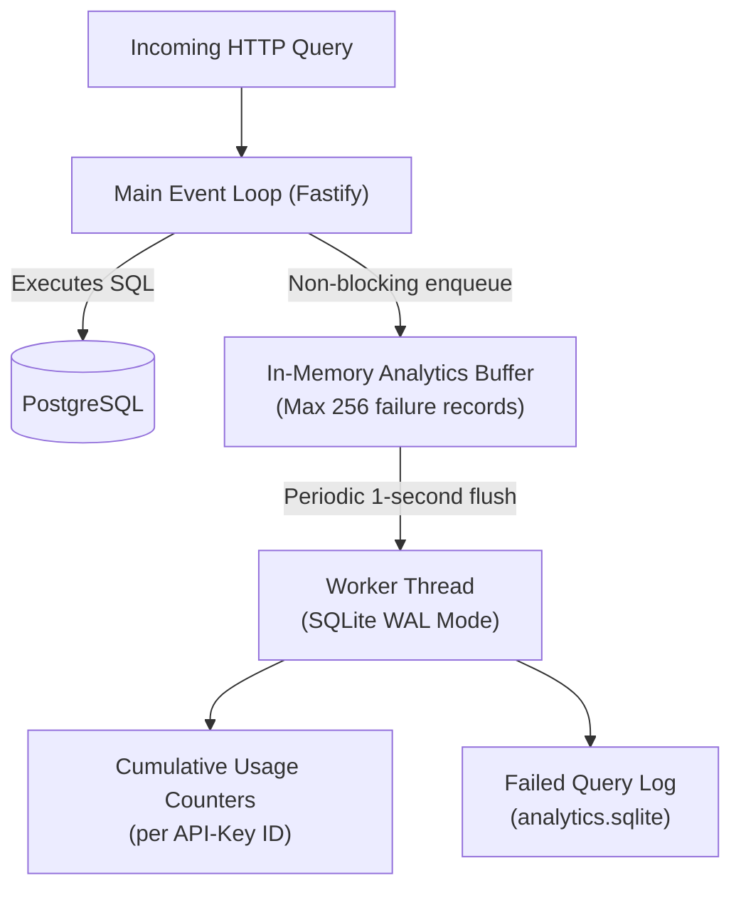

# Analytics & Observability Reference

HTTP PostgreSQL Gateway includes a high-performance, non-blocking analytics subsystem for tracking query volumes, per-key usage, and execution failures.

---

## Worker Thread Architecture



1. **Zero Impact on Latency:** SQL query responses never wait for disk I/O. The main thread updates an in-memory buffer and returns immediately.
2. **Dedicated Worker Thread:** A background worker thread drains the in-memory buffer and writes batched entries into `analytics.sqlite` inside a single SQLite transaction every second.
3. **Graceful Degradation:** If the worker restarts or SQLite is temporarily unavailable, pending events are held in memory or spooled to `analytics-pending.json`. SQL query execution continues unaffected.

---

## What Gets Counted

Analytics tracks cumulative usage keyed by the immutable **API Key Record ID**:

- `totalQueries`: Total number of query executions attempted.
- `failedQueries`: Number of queries resulting in an HTTP status $\ge 400$.
- `lastUsedAt`: Timestamp of the most recent query execution.

### Counting Rules:
- An immediate or asynchronous `POST /query` counts as **1 query**.
- A transaction batch (`POST /transaction/execute`) counts **each statement executed**. If statement 3 fails in a 5-statement batch, statements 1 and 2 count as successful, statement 3 counts as failed, and statements 4 and 5 are skipped and not counted.
- Health checks, admin calls, and idempotent replays do **not** increment query counters.

---

## Automatic SQL Sanitization (Redaction)

::warning
**Successful SQL is never stored.** The gateway logs SQL text **only for failed queries**.
::

With the default setting `analytics.storeFullSql: false`:
- The gateway's PostgreSQL-aware sanitizer strips comments.
- All single-quoted string literals (`'secret'`), dollar-quoted bodies (`$$secret$$`), and numeric literals are replaced with `?`.
- Bound parameters are **never** stored in analytics.

### Sanitization Example:

**Original Failed Query:**
```sql
SELECT * FROM users WHERE ssn = '123-45-6789' AND pin = 4821;
```

**Stored in Analytics:**
```sql
SELECT * FROM users WHERE ssn = ? AND pin = ?;
```

If complete query text is required for internal debugging, set `analytics.storeFullSql: true` in `gateway.yaml`.

---

## Storage Quotas & Pruning

Configuration in `gateway.yaml`:

```yaml
analytics:
  enabled: true
  directory: "./data/analytics"
  retentionDays: 30
  maxStorageBytes: 67108864 # 64 MiB
  storeFullSql: false
```

- **Retention Pruning:** Expired failure records older than `retentionDays` are pruned automatically in bounded batches during maintenance runs.
- **Quota Cap:** Maintenance runs every 60 seconds (or immediately when storage reaches 75% of `maxStorageBytes`). If disk usage exceeds the cap, the oldest failure details are purged to preserve headroom. Cumulative counters are never deleted by quota pruning.
