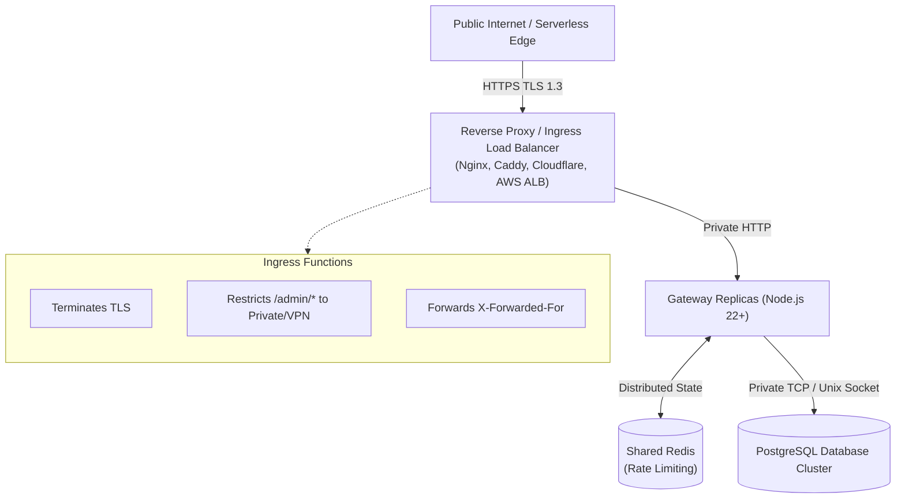

# Production Deployment Guide

This guide covers operational best practices for deploying HTTP PostgreSQL Gateway as a long-running, resilient service.

---

## Recommended Topology



---

## Building the Deployment Artifact

Compile TypeScript and build the production distribution:

```bash
# 1. Install production dependencies with locked versions
npm ci

# 2. Compile TypeScript
npm run build

# 3. Start production server
npm start
```

The runtime artifact requires:
- `dist/` (compiled JavaScript)
- `node_modules/` (production dependencies)
- `package.json`
- `gateway.yaml`
- Writable directories for `data/` and `logs/`

---

## Systemd Service Configuration

For Linux hosts, create `/etc/systemd/system/http-postgres.service`:

```ini
[Unit]
Description=HTTP PostgreSQL Gateway
After=network.target redis.service postgresql.service

[Service]
Type=simple
User=http-postgres
Group=http-postgres
WorkingDirectory=/opt/http-postgres
EnvironmentFile=/etc/http-postgres/gateway.env
ExecStart=/usr/bin/node dist/index.js
Restart=always
RestartSec=5
TimeoutStopSec=65

# Security sandbox
ProtectSystem=strict
ProtectHome=true
ReadWritePaths=/opt/http-postgres/data /opt/http-postgres/logs
PrivateTmp=true
NoNewPrivileges=true

[Install]
WantedBy=multi-user.target
```

Reload and start:

```bash
sudo systemctl daemon-reload
sudo systemctl enable --now http-postgres
```

---

## Reverse Proxy Configuration (Nginx)

```nginx
# Upstream gateway cluster
upstream gateway_cluster {
    server 127.0.0.1:8080;
    keepalive 32;
}

server {
    listen 443 ssl http2;
    server_name pg-gw.internal.example.com;

    ssl_certificate /etc/ssl/certs/gateway.crt;
    ssl_certificate_key /etc/ssl/private/gateway.key;

    # Protect administrative endpoints
    location /admin/ {
        allow 10.0.0.0/8;       # Allow internal corporate VPN only
        deny all;

        proxy_pass http://gateway_cluster;
        proxy_set_header Host $host;
        proxy_set_header X-Real-IP $remote_addr;
        proxy_set_header X-Forwarded-For $proxy_add_x_forwarded_for;
    }

    # Public / Serverless query endpoints
    location / {
        proxy_pass http://gateway_cluster;
        proxy_http_version 1.1;
        proxy_set_header Connection "";
        proxy_set_header Host $host;
        proxy_set_header X-Real-IP $remote_addr;
        proxy_set_header X-Forwarded-For $proxy_add_x_forwarded_for;

        # Timeouts: Must exceed the gateway's 35-second immediate query deadline
        proxy_connect_timeout 10s;
        proxy_read_timeout 45s;
        proxy_send_timeout 45s;

        # Disable automatic POST retries!
        proxy_next_upstream error timeout invalid_header;
        proxy_next_upstream_tries 1;
    }
}
```

---

## Graceful Shutdown

When receiving `SIGINT` or `SIGTERM`:
1. The gateway immediately stops accepting new HTTP connections.
2. Active immediate queries and in-flight transactions are granted a drain window to finish executing and committing.
3. Pending role cleanup routines run.
4. Active query connection pools are cleanly closed.
5. A second signal forces an immediate exit.

::tip
Configure your orchestrator (Kubernetes `terminationGracePeriodSeconds` or systemd `TimeoutStopSec`) to at least **65 seconds** to allow in-flight transactions (60s max deadline) to finish committing cleanly.
::

---

## Backup & Disaster Recovery

| Component | Backup Procedure |
| :--- | :--- |
| **Key Metadata (`data/data.json`)** | Back up on every key creation or scope edit. Encrypt at rest. |
| **PostgreSQL Schema (`http_postgres_gateway`)** | Included automatically in standard PostgreSQL backups (`pg_dump`). |
| **Analytics (`data/analytics/`)** | Ephemeral observability metrics; backup optional. |

### Restore Procedure:
1. Restore PostgreSQL database and confirm database identity bindings.
2. Restore `data/data.json` to the gateway host.
3. Start one gateway instance and verify authenticated health via `GET /admin/health`.
4. Test a read-only query before routing write traffic.
